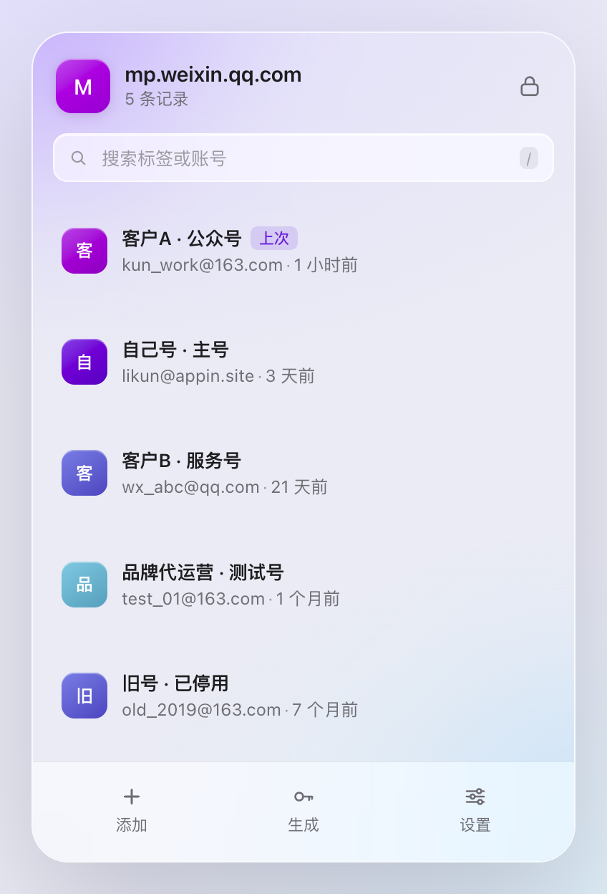
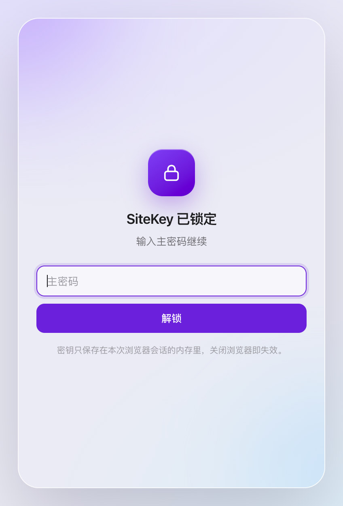
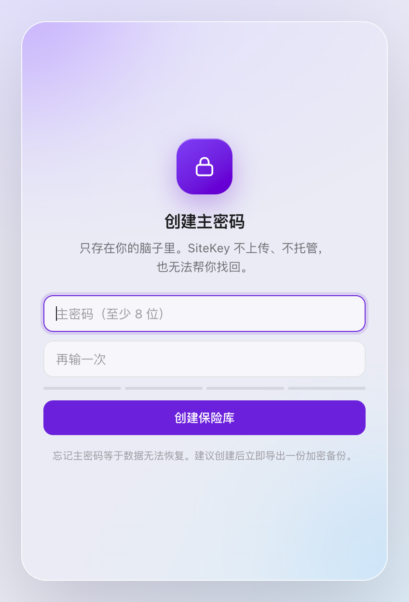
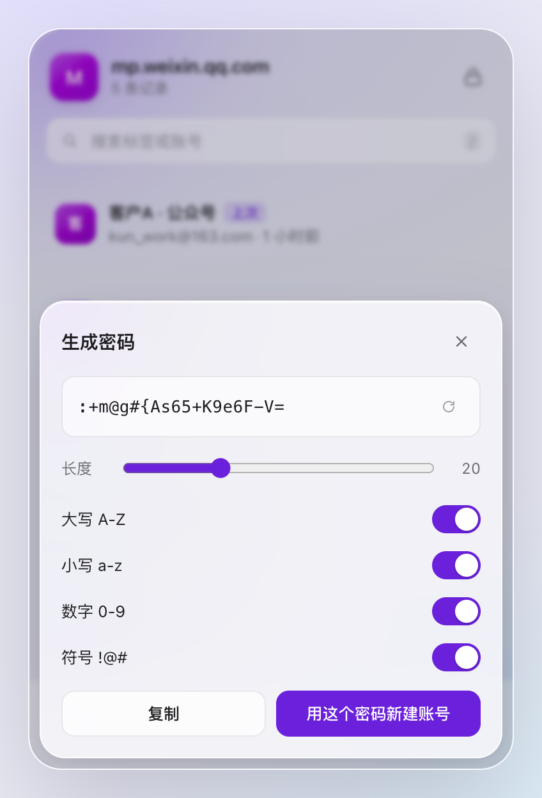
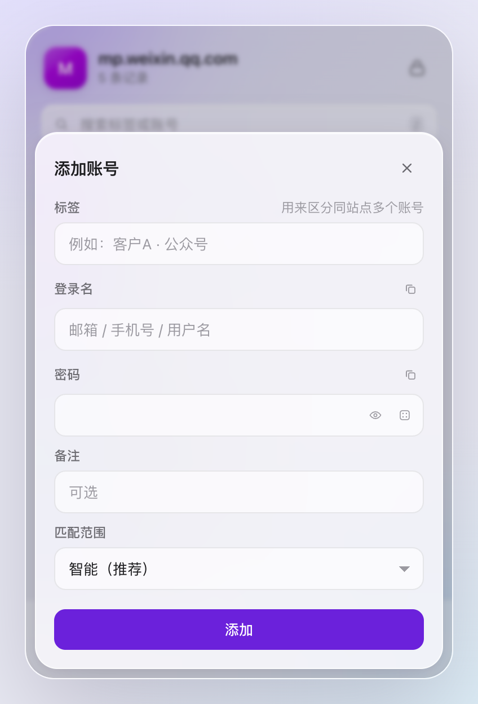
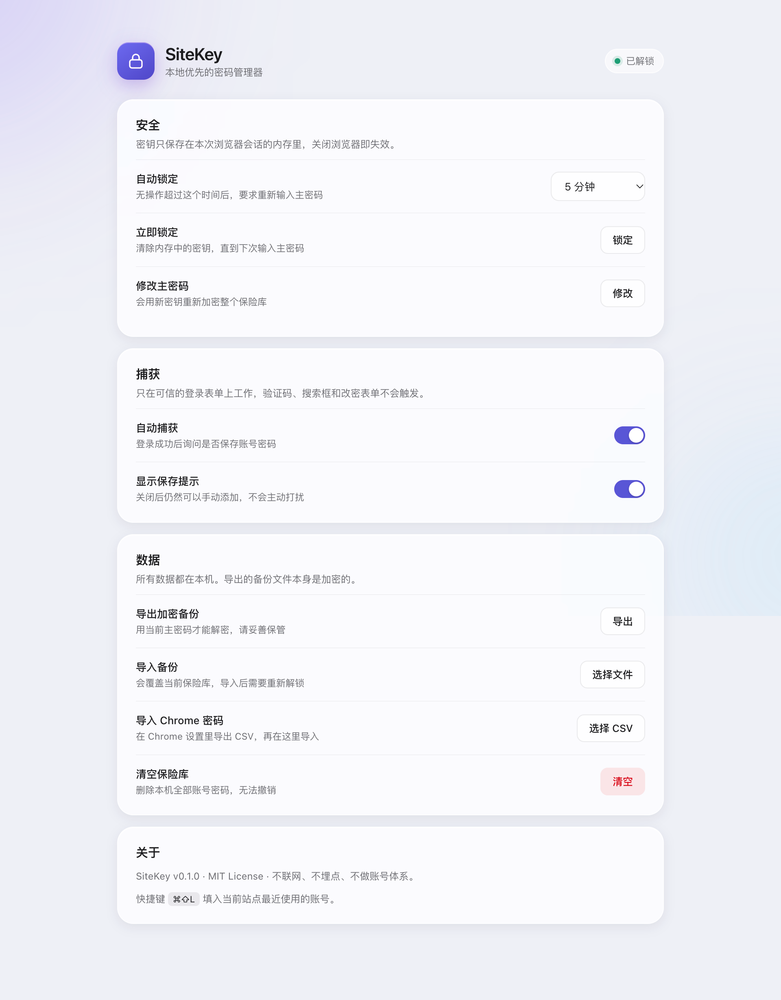

# SiteKey · 站点钥匙

本地优先的浏览器密码管理器。只解决两件最烦的事：

1. **同一个网站有多个账号，分不清哪个是哪个。** 每条记录都有用户自己定义的「标签」，标签排在第一行，登录名退到第二行。微信公众平台、多个客户后台、多个测试号，一眼就能认出来。
2. **验证码框、搜索框、信息登记框乱弹保存密码。** 只有通过「登录表单资格门禁」的表单才会被捕获或填充；验证码字段永远不会成为账号候选，也永远不会被注入任何 UI。

不联网、不埋点、不做账号体系。数据只在本机，用主密码加密。



## 界面

<p align="center">
  
  
  
  
</p>

<p align="center">
  
</p>

## 特性

- **标签优先的多账号管理**：标签、备注、最近使用时间、使用次数；同站账号按上次使用排序。
- **精准站点匹配**：智能 / 仅此域名 / 整站 / 自定义规则四种范围。`qq.com`、`google.com` 这类一个域名下挂无数服务的大站，智能模式会自动退化为精确 host，公众号的密码不会跑到 QQ 邮箱。
- **登录表单资格门禁**：正负信号打分 + 阈值判定，验证码 / 搜索 / 注册改密 / 支付证件 / 孤立密码框一票否决。
- **登录成功后提示保存**：不在输入过程中打断，只在提交并跳转（或 SPA 登录动作）之后弹一个轻量提示。
- **加密保险库**：PBKDF2-SHA256（310,000 次）+ AES-256-GCM，主密码不落盘。
- **本地优先**：`chrome.storage.local` 只存密文，零网络请求。
- **自动锁定**：默认 5 分钟无操作锁定，密钥只存在浏览器会话内存里。
- **加密备份**：导出/导入都是密文文件，换机不经过任何服务器。
- **Chrome 密码迁移**：导入 Chrome 导出的 CSV，自动建议标签。
- **快捷键**：`⌘⇧L` / `Ctrl+Shift+L` 填入当前站点最近使用的账号。
- **Liquid Glass 界面**：跟随系统深浅色，半透明玻璃层次，尊重「减少动态效果」。

## 安装（开发模式）

```bash
npm install
npm run build
```

然后：

1. 打开 `chrome://extensions`
2. 右上角开启「开发者模式」
3. 点「加载已解压的扩展程序」，选择本项目的 `dist/` 目录
4. 点击工具栏里的 SiteKey 图标，创建主密码

### 建议：关掉 Chrome 自带的密码保存

扩展没有 API 可以关闭 Chrome 密码管理器。为了避免双提示、双填充，建议手动关闭：

`chrome://settings/passwords` → 关闭「自动登录」和「提示保存密码」。

之后 SiteKey 作为唯一可信源。

## 使用

- **保存**：正常登录一次。提交成功后，页面右下角会出现玻璃提示，确认标签后保存。
- **填入**：点工具栏图标，点账号行即可填入；或按 `⌘⇧L` 填入最近使用的账号。
- **区分账号**：新建/编辑时填「标签」，例如「客户A · 公众号」。
- **匹配范围**：
  - **智能（推荐）**：同注册域匹配，但 `qq.com` / `google.com` 等多服务平台只匹配精确域名。
  - **仅此域名**：只在当前 host 下出现。
  - **整个站点**：同注册域全部出现。
  - **自定义规则**：支持 `*.example.com`。
- **迁移**：设置页 → 数据 → 导入 Chrome 密码（先在 Chrome 设置里导出 CSV）。

## 安全模型

| 项目 | 实现 |
|---|---|
| 密钥派生 | PBKDF2-SHA256，310,000 次迭代，16 字节随机盐 |
| 加密 | AES-256-GCM，每条密文 12 字节随机 IV |
| 主密码 | 不存储、不上传；只存验证密文 |
| 会话密钥 | `chrome.storage.session`（仅内存，浏览器关闭即失效） |
| 自动锁定 | 无操作超过设定时间即清除会话密钥 |
| 网络 | 无任何网络请求、无遥测、无第三方脚本 |
| 内容脚本 | 只在校验通过的表单上工作；只在用户点击填入/保存时收到单条凭证 |

**已知安全边界：**

- 剪贴板只在弹窗保持打开且聚焦时，30 秒后自动清空；弹窗关闭后无法代为清空。
- 不支持系统生物识别解锁（v0.1）。
- 主密码忘记后无法恢复，这是加密设计的必然结果。请导出加密备份。

## 站点识别规则

1. 用内置 Public Suffix 子集把 host 归一到可注册域（`co.uk`、`com.cn`、`com.hk` 等）。
2. `smart` 模式下，同注册域视为同站；但 `qq.com`、`google.com`、`microsoft.com` 等共享平台只匹配精确 host。
3. `host` 模式精确匹配；`domain` 模式匹配整个注册域；`custom` 模式支持 `*.` 通配。
4. 账密去重键是「注册域 + 登录名 + 匹配范围」；标签不参与去重，可随时改。

内置后缀表是精简版，不是完整 PSL。未知的多级后缀会退化为 eTLD+1，这是刻意换取离线与体积的取舍。

## 表单资格门禁

**正向信号**

| 信号 | 分值 |
|---|---|
| 可见、可编辑的密码框 | +40（必需） |
| 用户名类字段（`autocomplete=username/email`、`type=email/tel`、name/id 含 user/login/account/mobile 等） | +30 |
| 登录语义按钮（登录 / 登入 / sign in / log in） | +20 |
| URL / 标题含登录语义 | +10 |

阈值 60。没有用户名框的孤立密码框直接判负（解锁、二次验证、支付密码）。

**一票否决**

- 注册 / 创建账号 / 重置 / 修改密码
- 支付、银行卡、身份证、CVV 字段
- 确认密码 / 新密码字段
- 搜索表单
- 密码框不可见、禁用或只读

**关于验证码**：验证码字段不会让整个登录表单作废——微信公众平台这类登录页本身就带图形验证码。正确做法是把验证码字段从「用户名候选」里剔除，并且永远不在它上面注入任何 UI。这也是本项目和 Chrome 自带管理器行为差异最大的一点。

## 目录结构

```
sitekey/
├── public/
│   ├── manifest.json        # MV3 清单
│   ├── popup.html
│   ├── options.html
│   └── icons/               # 代码生成的 PNG 图标
├── scripts/
│   ├── build.mjs            # esbuild 构建（4 个入口）
│   └── make_icons.py        # 无依赖图标渲染
└── src/
    ├── background/          # service worker：消息路由、会话锁、徽标、捕获暂存
    ├── content/             # 表单探测、资格门禁、填充、保存提示
    ├── core/                # 加密、域名、存储、CSV、生成器、类型
    ├── popup/               # 弹窗（含 file:// 预览用的 mock）
    ├── options/             # 设置页
    └── shared/theme.css     # 设计变量（深浅色）
```

## 开发

```bash
npm run dev        # 监听构建（等同于 npm run watch）
npm run typecheck  # tsc --noEmit
npm run icons      # 重新生成图标
```

弹窗支持脱离扩展预览：构建后直接用浏览器打开 `dist/popup.html`，会自动启用内存 mock 数据；加 `?state=locked` 或 `?state=setup` 可以预览锁定/初始化状态。

## 路线图

- v0.2：TOTP / 二次验证码、站点级规则管理、密码健康度
- v0.3：加密文件同步（用户自选网盘）、Firefox / Safari 适配
- v0.4：Passkey 支持调研、导入 1Password / Bitwarden

## 已知限制

- 扫码登录、SSO、无密码登录捕获不到，只能手动保存。
- 跨域 iframe 内的登录框受浏览器安全模型限制，读不到字段。
- 用户名与密码分两步输入的登录流程（先输邮箱再输密码）无法自动关联。
- Chrome 自带密码管理器只能手动关闭，扩展无法代劳。
- 内置 PSL 是精简版，极少数多级后缀可能识别不准。

## 贡献

欢迎提 issue 和 PR。改动前请先跑 `npm run typecheck` 和 `npm run build`，并说明改动影响的是「站点识别」「表单门禁」还是「界面」。

## License

[MIT](LICENSE) © 2026 KUN.LI
