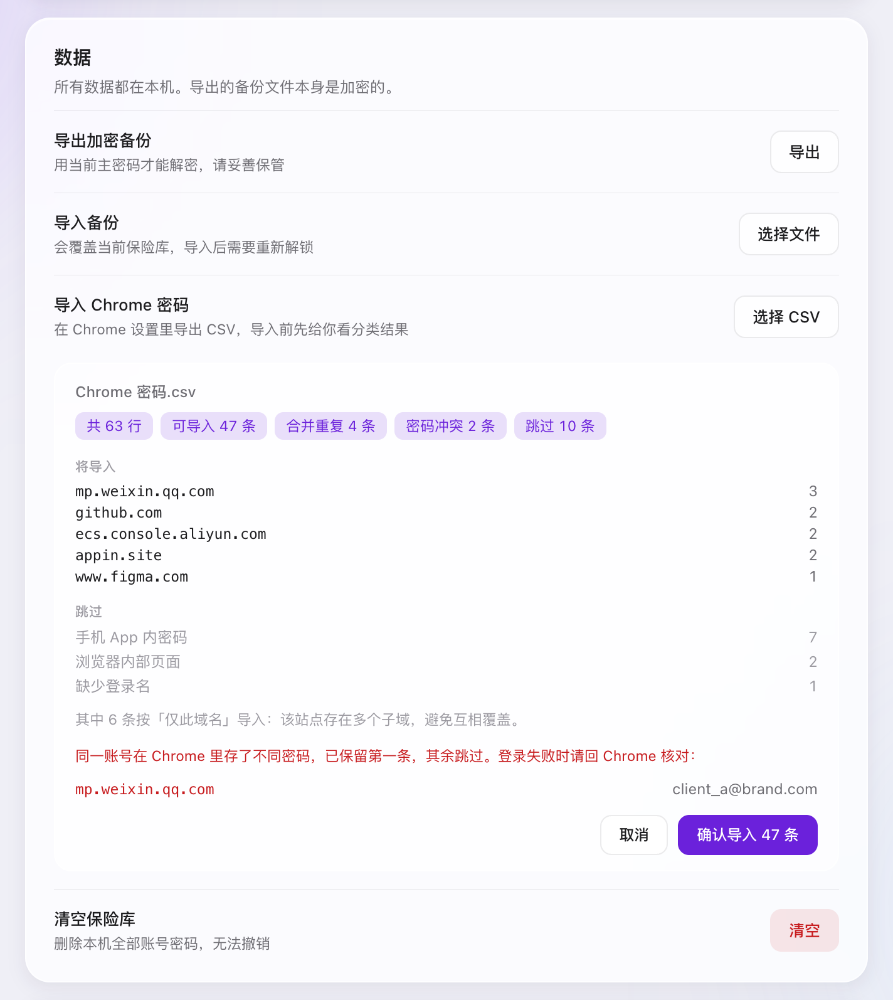

<p align="center">
  
</p>

<h1 align="center">SiteKey · 站点钥匙</h1>

<p align="center">
  
  
  
  
</p>

**SiteKey** is a local-first browser password manager. Your passwords stay encrypted on your own machine (PBKDF2-SHA256 + AES-256-GCM), it captures logins only after a successful submit, and never touches CAPTCHA or search fields. No account, no server, no telemetry. 中文文档见下文。

> 🚧 **状态 / Status：v0.1** — 功能开发已完成，但**尚未上架 Chrome 应用商店**。当前仅支持「开发者模式手动加载」安装（见下方「安装」）。商店上架与打包发布是后续计划。

本地优先的浏览器密码管理器。只解决两件最烦的事：

1. **同一个网站有多个账号，分不清哪个是哪个。** 每条记录都有用户自己定义的「标签」，标签排在第一行，登录名退到第二行。微信公众平台、多个客户后台、多个测试号，一眼就能认出来。
2. **验证码框、搜索框、信息登记框乱弹保存密码。** 只有通过「登录表单资格门禁」的表单才会被捕获或填充；验证码字段永远不会成为账号候选，也永远不会被注入任何 UI。

不联网、不埋点、不做账号体系。数据只在本机，用主密码加密。


## 界面

<p align="center">
  
  
  
  
</p>

<p align="center">
  
</p>

## 特性

- **标签优先的多账号管理**：标签、备注、最近使用时间、使用次数；同站账号按上次使用排序。
- **精准站点匹配**：智能 / 仅此域名 / 整站 / 自定义规则四种范围。`qq.com`、`google.com` 这类一个域名下挂无数服务的大站，智能模式会自动退化为精确 host，公众号的密码不会跑到 QQ 邮箱。
- **登录表单资格门禁**：硬条件 + 一票否决，验证码 / 搜索 / 注册改密 / 支付证件 / 孤立密码框一个都不放行。
- **登录成功后提示保存**：不在输入过程中打断，只在提交并跳转（或 SPA 登录动作）之后弹一个轻量提示。
- **加密保险库**：PBKDF2-SHA256（310,000 次）+ AES-256-GCM，主密码不落盘。
- **本地优先**：`chrome.storage.local` 只存密文，零网络请求。
- **自动锁定**：默认 5 分钟无操作锁定，密钥只存在浏览器会话内存里。
- **加密备份与多机合并**：导出/导入都是密文文件，换机不经过任何服务器；导入按修改时间合并，删除也会同步，不是覆盖。
- **Chrome 密码迁移**：导入前先给分类报告——哪些能导、哪些是 App 内密码、哪些撞了密码，确认后才写库。
- **快捷键**：`⌘⇧L` / `Ctrl+Shift+L` 填入当前站点最近使用的账号。
- **Liquid Glass 界面**：跟随系统深浅色，半透明玻璃层次，尊重「减少动态效果」。

## 安装

> 尚未上架 Chrome 应用商店，需要「开发者模式」加载。商店上架在路线图中。

**方式一：下载即用（不需要 Node）**

1. 到 [Releases](https://github.com/imlikun/sitekey/releases/latest) 下载 `sitekey-v0.1.0.zip`，解压到一个**固定目录**（之后不要删，Chrome 会持续从这个目录加载；解压后应直接看到 `manifest.json`）
2. 打开 `chrome://extensions`
3. 右上角开启「开发者模式」
4. 点「加载已解压的扩展程序」，选择刚才解压的目录
5. 点击工具栏里的 SiteKey 图标，创建主密码

**方式二：从源码构建（开发者）**

```bash
npm install
npm run build
```

然后在 `chrome://extensions` 里加载本项目的 `dist/` 目录。

> 开发者模式加载的扩展，Chrome 启动时可能提示「请停用以开发者模式运行的扩展程序」，点关闭即可，不影响使用。

### 建议：关掉 Chrome 自带的密码保存

扩展没有 API 可以关闭 Chrome 密码管理器。为了避免双提示、双填充，建议手动关闭：

`chrome://settings/passwords` → 关闭「自动登录」和「提示保存密码」。

之后 SiteKey 作为唯一可信源。

## 使用

- **保存**：正常登录一次。提交成功后，页面右下角会出现玻璃提示，确认标签后保存。
- **填入**：点工具栏图标，点账号行即可填入；或按 `⌘⇧L` 填入最近使用的账号。
- **复制**：鼠标移到账号行上，右侧会出现「复制密码」和「编辑」两个小按钮。页面不允许扩展写入时（`chrome://`、部分内嵌页），走这条路最快。
- **键盘**：`/` 聚焦搜索，`↓` 从搜索框直接落到第一条，`↑` `↓` 在行间移动，`Enter` 填入，`Esc` 关闭面板或清空搜索。
- **区分账号**：新建/编辑时填「标签」，例如「客户A · 公众号」。
- **匹配范围**：
  - **智能（推荐）**：同注册域匹配，但 `qq.com` / `google.com` 等多服务平台只匹配精确域名。
  - **仅此域名**：只在当前 host 下出现。
  - **整个站点**：同注册域全部出现。
  - **自定义规则**：支持 `*.example.com`。
- **迁移**：设置页 → 数据 → 导入 Chrome 密码（先在 Chrome 设置里导出 CSV）。

## 从 Chrome 迁移

### 1. 在 Chrome 里导出

1. 地址栏输入 `chrome://password-manager/settings`
2. 找到「导出密码」，点「下载文件」
3. 用 Touch ID / 系统密码验证一次
4. 保存下来，文件名通常叫 `Chrome 密码.csv`（UTF-8，逗号分隔，5 列：`name,url,username,password,note`）

菜单路径一样：`⋮` → 密码和自动填充 → Google 密码管理工具 → 设置 → 导出密码。企业策略可能禁用导出，那就只能逐条手动搬。

> ⚠️ 这个文件是**明文**。谁拿到谁能读，导入完立刻删除，别留在下载目录、iCloud 或网盘里。

### 2. 导入前先看分类结果

SiteKey 不会拿到文件就往库里灌。选完 CSV 先出一份解析报告，确认后才写库：



### 3. 解析规则

每一行先分类，不是所有行都值得导入：

| 行类型 | 判断依据 | 处理 |
|---|---|---|
| 网页登录 | `http(s)://` 且能解析出 host | 导入 |
| 手机 App 内密码 | `android://`、`ios://` 等非 http 协议 | 跳过（桌面没有对应登录页） |
| 浏览器内部页面 | `chrome://`、`chrome-extension://`、`about:`、`file:` | 跳过 |
| 缺字段 | 没网址 / 没登录名 / 没密码 | 跳过，按原因分别计数 |
| 裸域名 | 没写协议头，如 `example.com/login` | 按 https 补全后导入 |

去重与冲突：

| 情况 | 判断 | 处理 |
|---|---|---|
| 完全重复 | 同 host + 同登录名 + 同密码 | 合并成 1 条 |
| 密码冲突 | 同 host + 同登录名 + 不同密码 | 保留第一条，其余跳过并在报告里点名 |
| 同站多子域 | 注册域相同、host 不同 | 自动降级为「仅此域名」导入，避免 `a.x.com` 覆盖 `b.x.com` |

标签怎么定，是这份 CSV 最难的一步。Chrome 的 `name` 列经常直接是站点名或域名，照搬会让同一站点的多个账号全叫一个名字——正是 SiteKey 要解决的痛点。所以：

1. 同一 host 下每条记录的 `name` 都不同、且不像站点名（不等于域名、不以 `www.` 开头、不是 URL）→ 用 `name`
2. 否则用登录名派生：邮箱取 `@` 前面，手机号取尾号 4 位
3. 同一 host 下标签仍然撞车 → 追加序号

表头按别名匹配：`url` / `website` / `origin`、`username` / `login` / `user`、`password`、`name` / `title`、`note` / `notes`。支持 BOM、引号内的逗号与换行、`""` 转义。解析逻辑有独立测试（`npm test`），覆盖多行备注、转义引号、子域冲突、BOM 等情况。

## 多台电脑之间同步

没有账号、没有服务器，靠**加密备份文件**在机器之间搬。导入是**合并**，不是覆盖。

标准做法：

1. 在第一台建好库，设置 → 数据 → 导出加密备份
2. 第二台装好扩展后**先导入这份备份**。空库会直接接管，连主密码一起，之后两台用同一个密码
3. 之后任何一台上新增、修改、删除，导出 → 另一台导入即可
4. 备份文件丢进 iCloud / OneDrive 之类的同步目录，就只剩「点一下导入」这一步

两台机器如果各自建过库（主密码也可能不同），导入时会要求输入**备份那台机器的密码**，解开后与本机合并，结果用本机密码重新加密。所以密码不同也能合并，不需要先统一。

合并规则：

| 情况 | 处理 |
|---|---|
| 同一个 id | 比最后修改时间，新的胜出 |
| id 不同、但同域同账号 | 认作同一条，留新的，避免两边各加一次变成重复 |
| 一边删除 | 留墓碑同步，不会在另一台复活 |
| 同一份备份连导两次 | 第二次不会产生任何变化（幂等） |

边界：合并只覆盖记录本身，`autoLockMinutes` 这类设置项不参与同步；墓碑会一直保留在密文里（每条几十字节），暂时不做清理。

## 安全模型

| 项目 | 实现 |
|---|---|
| 密钥派生 | PBKDF2-SHA256，310,000 次迭代，16 字节随机盐 |
| 加密 | AES-256-GCM，每条密文 12 字节随机 IV |
| 主密码 | 不存储、不上传；只存验证密文 |
| 会话密钥 | `chrome.storage.session`（仅内存，浏览器关闭即失效） |
| 自动锁定 | 无操作超过设定时间即清除会话密钥 |
| 网络 | 无任何网络请求、无遥测、无第三方脚本 |
| 内容脚本 | 只在校验通过的表单上工作；只在用户点击填入/保存时收到单条凭证 |

**已知安全边界：**

- 剪贴板只在弹窗保持打开且聚焦时，30 秒后自动清空；弹窗关闭后无法代为清空。
- 不支持系统生物识别解锁（v0.1）。
- 主密码忘记后无法恢复，这是加密设计的必然结果。请导出加密备份。

## 站点识别规则

1. 用内置 Public Suffix 子集把 host 归一到可注册域（`co.uk`、`com.cn`、`com.hk` 等）。
2. `smart` 模式下，同注册域视为同站；但 `qq.com`、`google.com`、`microsoft.com` 等共享平台只匹配精确 host。
3. `host` 模式精确匹配；`domain` 模式匹配整个注册域；`custom` 模式支持 `*.` 通配。
4. 账密去重键是「注册域 + 登录名 + 匹配范围」；标签不参与去重，可随时改。

内置后缀表是精简版，不是完整 PSL。未知的多级后缀会退化为 eTLD+1，这是刻意换取离线与体积的取舍。

## 表单资格门禁

自动保存和快捷键填充走的是同一套判定，门禁只有一份：

**硬条件（缺一不可）**

1. 密码框可见、可编辑，且不是 `autocomplete="new-password"`
2. 同一容器里能找到可信的账号输入框——搜索框、验证码框不参与候选
3. 没有命中任何一条「一票否决」

**一票否决**

- 注册 / 创建账号 / 重置 / 修改密码
- 支付、银行卡、身份证、CVV 字段
- 确认密码 / 新密码字段
- 搜索表单
- 密码框不可见、禁用或只读

**排序分数**（只在同页有多个候选表单时决定先填哪个，不参与「能不能填」）

| 信号 | 分值 |
|---|---|
| 密码框可见、可编辑 | 40 |
| 找到配对的账号输入框 | 30 |
| 登录语义按钮（登录 / 登入 / sign in / log in） | +20 |
| URL / 标题含登录语义 | +10 |

**关于验证码**：验证码字段不会让整个登录表单作废——微信公众平台这类登录页本身就带图形验证码。正确做法是把验证码字段从「用户名候选」里剔除，并且永远不在它上面注入任何 UI。这也是本项目和 Chrome 自带管理器行为差异最大的一点。

## 目录结构

```
sitekey/
├── public/
│   ├── manifest.json        # MV3 清单
│   ├── popup.html
│   ├── options.html
│   └── icons/               # 代码生成的 PNG 图标
├── scripts/
│   ├── build.mjs            # esbuild 构建（4 个入口）
│   └── make_icons.py        # 无依赖图标渲染
├── tests/
│   ├── csv.test.mjs         # Chrome CSV 解析与去重规则
│   ├── merge.test.mjs       # 多机合并：时间戳、语义键、墓碑
│   ├── sync.test.mjs        # 三台设备跑真实加密链路的端到端同步
│   ├── import.test.mjs      # CSV 导入 × 多机同步的交叉场景
│   ├── detector.test.mjs    # 表单门禁：支付/注册/搜索页必须填不进去
│   └── e2e.mjs              # 真浏览器端到端：装扩展跑完整用户链路（15 项）
└── src/
    ├── background/          # service worker：消息路由、会话锁、徽标、捕获暂存
    ├── content/             # 表单探测、资格门禁、填充、保存提示
    ├── core/                # 加密、域名、存储、CSV、生成器、类型
    ├── popup/               # 弹窗（含 file:// 预览用的 mock）
    ├── options/             # 设置页
    └── shared/theme.css     # 设计变量（深浅色）
```

## 开发

```bash
npm run dev        # 监听构建（等同于 npm run watch）
npm run test       # 全量断言：CSV、合并、三机同步、导入交叉、表单门禁
npm run test:e2e   # 真浏览器端到端：构建后加载 dist/ 跑 15 项完整链路
npm run verify     # 一条命令回归：typecheck + 单测 + 端到端
npm run typecheck  # tsc --noEmit
npm run icons      # 重新生成图标
```

`npm run test:e2e` 需要一个完整的 Chromium（不能是 headless shell，扩展在 shell 里加载不了）。脚本会按这个顺序自动找：`SITEKEY_BROWSER` 环境变量 → `playwright-core` 自带的浏览器 → Playwright 缓存 → 系统安装的 Chrome / Chromium / Edge。如果一台都没找到，执行 `npx playwright install chromium` 即可（只下浏览器，不装测试框架）。想看着它跑就加 `SITEKEY_E2E_HEADED=1`。

端到端覆盖 15 项，重点守住三条产品红线：**提交后才捕获**、**验证码永不成为账号**、**注册/改密页不打扰**；另外覆盖锁定/解锁、填入、CSV 分类报告、换主密码后的跨库合并与幂等。

弹窗支持脱离扩展预览：构建后直接用浏览器打开 `dist/popup.html`（不需要起本地服务器），会自动启用内存 mock 数据；加 `?state=locked` 或 `?state=setup` 可以预览锁定/初始化状态。为此 popup / options 两个入口打成 IIFE，而不是 ES module——`file://` 下浏览器会拦截 module 的跨源加载。

## 路线图

- v0.2：TOTP / 二次验证码、站点级规则管理、密码健康度
- v0.3：自动同步（WebDAV / 自选网盘，免去手动导入导出）、Firefox / Safari 适配
- v0.4：Passkey 支持调研、导入 1Password / Bitwarden

## 已知限制

- 扫码登录、SSO、无密码登录捕获不到，只能手动保存。
- Passkey 不在 Chrome 的 CSV 里，只能留在 Google 密码管理工具中。
- Chrome CSV 里同一账号若存了多条不同密码，导入只保留第一条，需要手动核对。
- 跨域 iframe 内的登录框受浏览器安全模型限制，读不到字段。
- 用户名与密码分两步输入的登录流程（先输邮箱再输密码）无法自动关联。
- 搜索框靠 name / id / placeholder 里的关键词识别（`q`、`kw`、`wd`、`search`、`搜索` 等），个别站点用自定义缩写命名时可能漏判。
- Chrome 自带密码管理器只能手动关闭，扩展无法代劳。
- 内置 PSL 是精简版，极少数多级后缀可能识别不准。

## 贡献

欢迎提 issue 和 PR。改动前请先跑 `npm run typecheck` 和 `npm run build`，并说明改动影响的是「站点识别」「表单门禁」还是「界面」。

## License

[MIT](LICENSE) © 2026 KUN.LI
